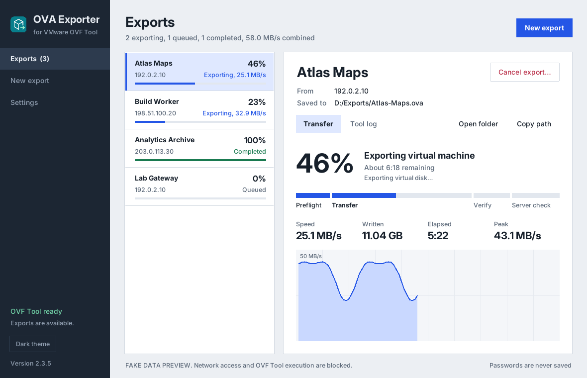
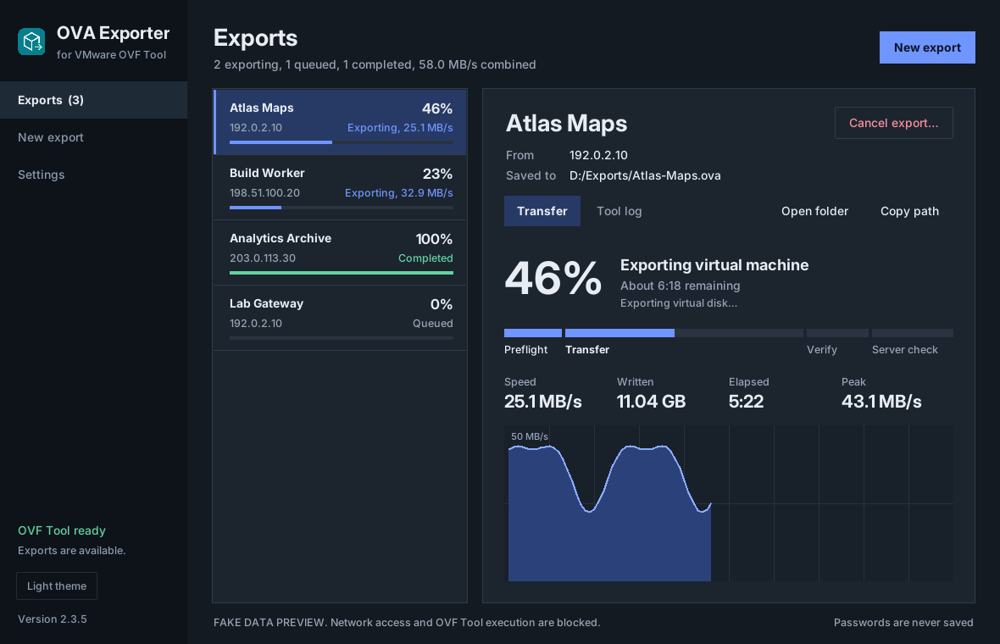
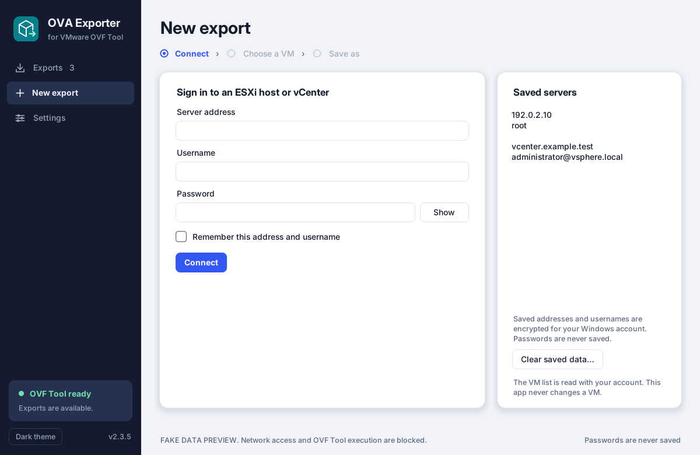
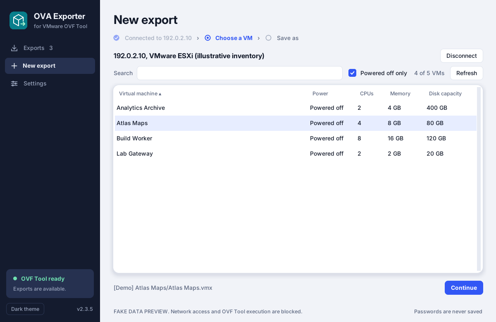
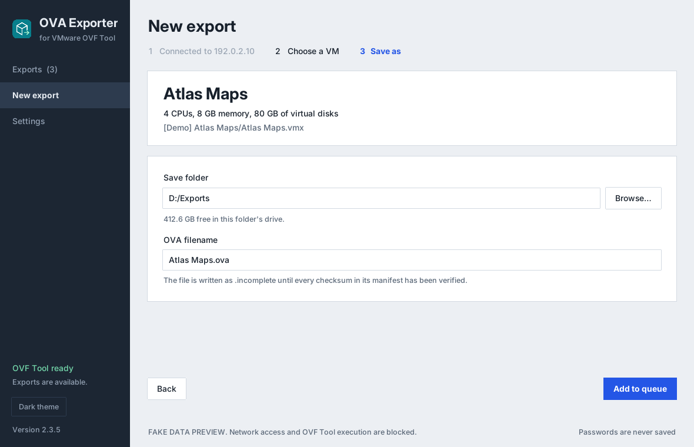
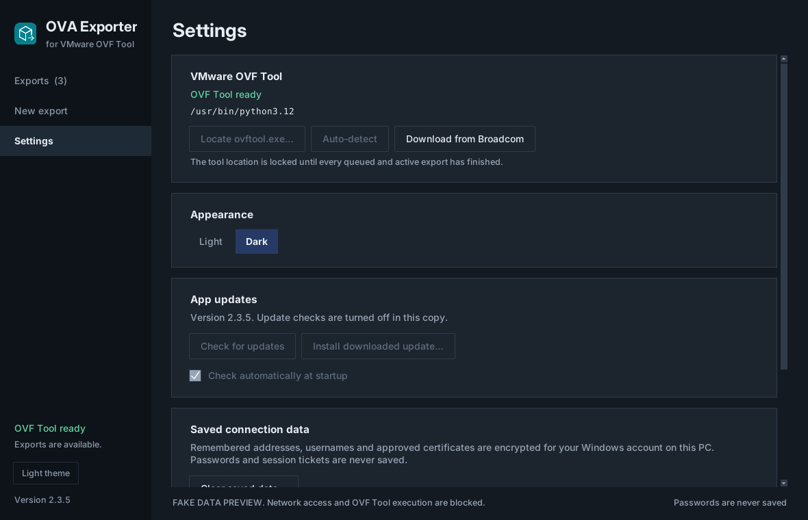
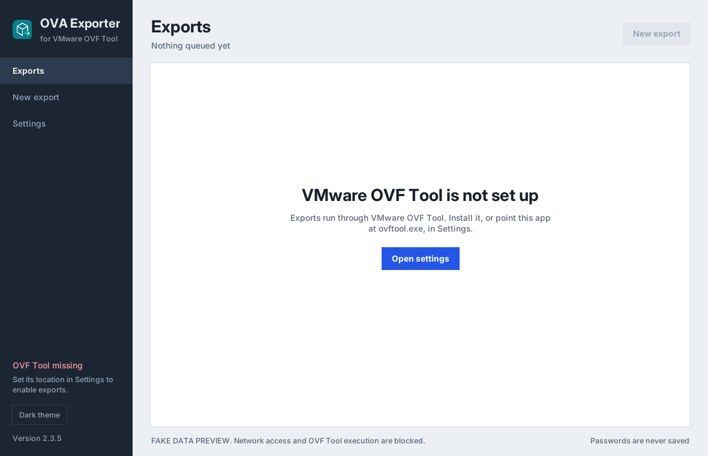
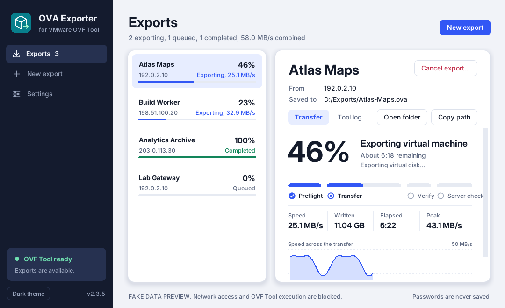

<div align="center">


# OVA Exporter GUI

**Export VMware virtual machines to OVA from a calm, single-window Windows app.**<br>
A graphical front end for VMware OVF Tool, with checksum verification built in.

[](https://github.com/abdomitov/ova-exporter-gui/actions/workflows/offline-tests.yml)
[](https://github.com/abdomitov/ova-exporter-gui/releases/latest)
[](LICENSE)


**[Download the installer](https://github.com/abdomitov/ova-exporter-gui/releases/latest)** ·
[Install guide](#install) · [Try it without VMware](#try-it-without-vmware) · [Docs](docs/ARCHITECTURE.md)

<br>



</div>

<br>

Independent community project. Not affiliated with or endorsed by Broadcom or VMware.
Provided as is under the MIT license; see [responsibility and third-party terms](#license-responsibility-and-third-party-terms).

## Why this exists

OVF Tool is reliable and has a long command line. This app keeps that engine and removes the typing:
sign in to an ESXi host or vCenter, pick a powered-off VM, choose where to save it, and watch the
export move through its stages. Several VMs can be queued in a row.

## What you get

| | |
| --- | --- |
| **Four-stage progress** | Preflight, Transfer, Verify and Server check are drawn as one track, so you always know what is happening and what comes next. |
| **Live transfer panel** | Large percentage, speed, bytes written, elapsed time, peak speed and a graph of speed across the transfer. |
| **A queue you can trust** | Up to three exports at once across servers, one per server address. Each task keeps its own log, progress and state. |
| **Verified packages** | The manifest is checked before an `.incomplete` file becomes the final `.ova`. Existing files are never overwritten. |
| **Three-step New export** | Connect, choose a VM (search, sort, powered-off filter), then save. The session stays open for the next VM. |
| **Light and dark themes** | Drawn rounded surfaces, icons and focus rings, with keyboard shortcuts throughout. |
| **Careful with secrets** | Passwords are typed for each connection and never stored. Saved servers and certificate approvals use Windows DPAPI. |
| **Updates you approve** | The app can tell you about a new installer, verify its checksum and install it when no export is running. |

<details>
<summary><b>More screens</b>: dark theme, the three steps, Settings and the missing-tool state</summary>

<br>















</details>

Screenshots are captured from the guarded fake-data preview on Linux; fonts differ slightly on Windows
(Bahnschrift and Segoe UI). VM names, addresses and progress are illustrative.

## Install

1. Open the [latest release](https://github.com/abdomitov/ova-exporter-gui/releases/latest) and download
   `OVA-Exporter-GUI-<version>-Windows-x64-Setup.exe`.
2. Run it. Installation is per user and needs no administrator rights by default. Python and Tk are included.
3. If Windows shows **Windows protected your PC**, see [the note below](#the-windows-protected-your-pc-screen).
4. Install [VMware OVF Tool](https://developer.broadcom.com/tools/open-virtualization-format-ovf-tool/latest/)
   separately. The app finds a standard installation automatically, or you can point to it in **Settings**.

Each release lists a SHA-256 checksum next to the installer. To check it in PowerShell:

```powershell
Get-FileHash .\OVA-Exporter-GUI-*-Windows-x64-Setup.exe -Algorithm SHA256
```

### The "Windows protected your PC" screen

The installer is not yet signed with a code-signing certificate, so Windows SmartScreen shows a blue
warning for files it has not seen often. It does not mean the file was found to be harmful. To continue,
click **More info**, then **Run anyway**, after comparing the SHA-256 above with the release page.

There is no setting in this repository that can turn the warning off, and no trustworthy workaround:
SmartScreen trusts a file only through a valid signature plus download history. The plan to remove it
is in [docs/CODE_SIGNING.md](docs/CODE_SIGNING.md). Until then, organizations can deploy the installer
through their own software distribution, where an administrator allows the file.

## Try it without VMware

To explore the interface with no VMware server, OVF Tool or network, download the source, install
Python 3.10 or newer, and double-click **Try the new UI.cmd**. It opens the app against a simulated
server: connect, pick a VM, queue it, watch it run and cancel it. Nothing is sent anywhere and no
files are written.

```powershell
py -3 tools/preview_ui.py --try
```

## Keyboard shortcuts

| Keys | Action |
| --- | --- |
| **Ctrl+N** | New export |
| **Ctrl+1 / 2 / 3** | Exports, New export, Settings |
| **Ctrl+F** | Jump to VM search |
| **F5** | Refresh the VM list |
| **Up / Down** | Move through the task list |

## App updates

By default the app checks this public repository once at startup for a newer Windows installer. Turn off
**Check automatically at startup** in **Settings** to stop that, or use **Check for updates** to look on
demand. The prompt offers **Update**, **Remind me later** (one day) and **Skip this version**.

Update downloads the installer and checks its size and SHA-256 against the published checksum, then
installs and reopens the app. Installation is blocked while exports are queued, transferring, verifying
or awaiting cleanup. The check sends no VMware credentials, server addresses or usernames; GitHub sees
the normal request, including your public IP address. A checksum is an integrity check, not a publisher
signature. VMware OVF Tool is updated separately by you.

**Maintainers:** no update server is needed. Publish a higher-version GitHub Release with the installer and
its checksum file. See [Publishing updates](docs/RELEASING.md).

## Requirements

- Windows 10/11 x64 is the target platform. Fresh install, upgrade and uninstall passed on a disposable GitHub-hosted Windows runner. Windows 10 and all end-user configurations remain unverified.
- Source users need Python 3.10 or newer with Tkinter. The Windows installer includes Python/Tk; users of that installer do not need a separate Python installation. No third-party Python packages are required to run the source app.
- [VMware OVF Tool](https://developer.broadcom.com/tools/open-virtualization-format-ovf-tool/latest/), installed separately under its own license.
- Access to the required VMware management and export endpoints and an account permitted to read inventory and export the chosen VM.
- A powered-off VM and sufficient free space for the export. The initial free-space check cannot predict the final compressed size.

## Run

**Windows users:** download the Setup executable from the
[latest release](https://github.com/abdomitov/ova-exporter-gui/releases/latest). It includes
Python/Tk and creates application shortcuts. VMware OVF Tool is installed separately.
See [installer details](docs/WINDOWS_INSTALLER.md) and the
[SmartScreen note](#the-windows-protected-your-pc-screen).

**Developers/source users:**

1. Install Python with its Windows launcher and Tkinter support.
2. Install VMware OVF Tool.
3. Download/extract this source folder and double-click **Start OVA Exporter.vbs**.

If Windows Script Host is unavailable, use **Start OVA Exporter.cmd** or:

```powershell
py -3 launch.pyw
```

OVF Tool is located in this order: `OVFTOOL_PATH`, a private `ovftool/ovftool.exe` beside the app, the standard VMware installation under Program Files, then `PATH`. The public source archive contains no VMware executable or DLL.

When `OVFTOOL_PATH` is explicitly set, that exact path is used. A missing override
produces an error rather than selecting a different installation. Selecting an
executable with **Locate OVF Tool** takes priority over automatic detection and
the environment override. The custom location is encrypted for your Windows
account. **Auto-detect** clears that custom location and checks again.

The installation directory does not need to be the default one. Choose the
official `ovftool.exe` and keep its supporting DLLs/folders intact. A red
missing-tool alert blocks new export setup; a found-tool status confirms file
presence, not VMware connectivity or full runtime health. Active tasks must finish
before changing tool locations.

For a custom installation, set the executable path before launching:

```powershell
$env:OVFTOOL_PATH = 'D:\Tools\VMware OVF Tool\ovftool.exe'
py -3 launch.pyw
```

## Export a VM

1. Click **New export** in the left rail or press **Ctrl+N**.
2. **Connect**: enter an ESXi or vCenter address, username and password, or click a saved server to fill the first two. Press **Enter** in the password field to connect. **Show** toggles password visibility.
3. Verify the certificate fingerprint before accepting it. The app remembers that exact certificate; a changed fingerprint requires review again.
4. **Choose a VM**: search, sort by any column, select a powered-off VM and click **Continue** (or double-click the row).
5. **Save as**: choose the folder and `.ova` filename, then **Add to queue**. Existing destination files are preserved.
6. The app switches to **Exports** and selects the new task. You stay signed in, so you can return to **New export** for another VM from the same server; click **Disconnect** when finished.

Shortcuts: **Ctrl+1/2/3** switch views, **Ctrl+F** jumps to VM search, **F5** refreshes the VM list,
**Up/Down** move through the task list. The selected task has **Transfer** and **Tool log** tabs,
plus **Open folder** and **Copy path**. Change the theme from the rail or in **Settings**.
The minimum window size is 1080 × 660.

Server aliases and a vCenter plus its ESXi host can refer to the same physical resources. The per-address queue cannot identify all such overlaps. Concurrent exports still share your PC's NIC, storage and any common network links.

## Progress and cancellation

Speed is derived from OVA file growth, not total adapter traffic. ETA is approximate and excludes subsequent verification and server cleanup. A verified OVA with a source-state warning is distinguished from a failed transfer.

Here, "verified" means the archive passed this app's manifest checksum checks.
It does not prove the guest can boot, that its applications/data are consistent,
that the archive is malware-free, or that a restore will succeed. This utility
does not replace a tested backup and recovery system.

**Cancelling a remote export can leave some ESXi versions stuck in an exporting state**, blocking power-on or later exports. See [Broadcom KB 334593](https://knowledge.broadcom.com/external/article/334593/unable-to-power-on-vm-with-error-the-att.html). A warning does not prevent that server defect. Letting transfers finish is preferable where possible.

Queued tasks and local verification can be cancelled independently. An active-export cancellation requires confirmation. If OVF Tool stalls, a separate force-stop confirmation ends only the process owned by that task; it cannot guarantee server cleanup. The app never restarts ESXi services or changes VM power state. Incomplete files are not valid completed exports and cannot be resumed.

## Privacy

The compatible data directory remains `%LOCALAPPDATA%\OVA Exporter`:

| File | Contents |
| --- | --- |
| `connections.json` | DPAPI-encrypted address/username hints, only when requested |
| `trusted_servers.json` | DPAPI-encrypted approved certificate fingerprints |
| `appearance.json` | Plain `light`/`dark` preference only |
| `tool_location.json` | DPAPI-encrypted custom OVF Tool path |
| `updates.json` | Plain automatic-check, skipped-version and reminder preferences; no connection data |
| `updates/` | Downloaded app installers; no OVA exports or VMware credentials |

There is no analytics or telemetry code. Diagnostics and task rows stay in memory by default. **Clear saved data** removes connection hints and certificate approvals. Passwords, cookies and session tickets are not written to these settings files. DPAPI protects stored data from casual file inspection and other Windows users; software running as the same Windows user can still decrypt it.

## Development

Want to learn the delivery process? Follow [Learn DevOps with this project](docs/DEVOPS_PATH.md)
for the branch → CI → Windows build → installer checks → draft → reviewed release path,
with practical exercises and tradeoffs. Build-only workflow runs do not publish an update.

Read [CONTRIBUTING.md](CONTRIBUTING.md) and [the architecture notes](docs/ARCHITECTURE.md). The existing offline regression suite uses fake clients; do not point tests at a production server.

Run `py -3 tools/offline_tests.py` for guarded offline regressions. See the
[release review](docs/RELEASE_REVIEW.md) for findings, fixes and unverified lab checks.
The [security review](docs/SECURITY_REVIEW.md) describes the tested attack fixtures
and remaining risks; the [repository review](docs/REPOSITORY_REVIEW.md) records
the current documentation, screenshot and release-automation checks.

An isolated visual preview is available without credentials or VMware binaries:

```powershell
py -3 tools/preview_ui.py
```

To click through the whole interface yourself (connect, choose a VM, queue, cancel) against a
simulated server, run `py -3 tools/preview_ui.py --try` or double-click **Try the new UI.cmd**.
Nothing is sent to a network and no files are written.

The default preview injects in-memory settings, fake VM inventory and progress, and blocks socket connections and subprocess creation. It cannot export a VM or save connection settings.

The repository keeps application code in `src/`, regression tests in `tests/`,
build helpers in `tools/`, installer configuration in `packaging/`, and user/developer
documentation in `docs/`. End users only need the installer download.

## License, responsibility and third-party terms

This project's source and published GitHub downloads are offered without payment
to the maintainers under the [MIT license](LICENSE), including its warranty
disclaimer and limitation of liability. The software is provided **as is**,
without a guarantee of error-free operation, suitability, successful recovery,
or protection against data loss. Use only on systems you are authorized to manage;
maintain independent backups and validate behavior in a disposable lab first.

Broadcom and VMware do not publish, endorse, certify or provide support for this
community project. We make no commitments on their behalf. VMware OVF Tool and
other VMware products retain their own license, support and commercial terms;
this project does not provide vendor licenses or waive vendor requirements,
charges, rights or obligations. Broadcom/VMware binaries are not included.

These notices describe this project's terms; they do not guarantee immunity from
claims or override applicable law. See [third-party notices](THIRD_PARTY_NOTICES.md).

## License

Application code: [MIT](LICENSE). VMware OVF Tool and Python retain their own licenses; they are not included in this source distribution. See [THIRD_PARTY_NOTICES.md](THIRD_PARTY_NOTICES.md).
