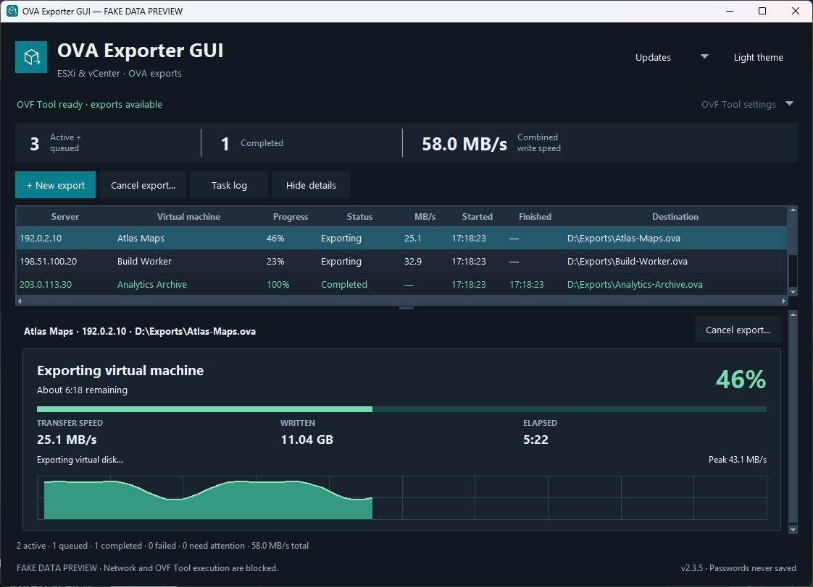
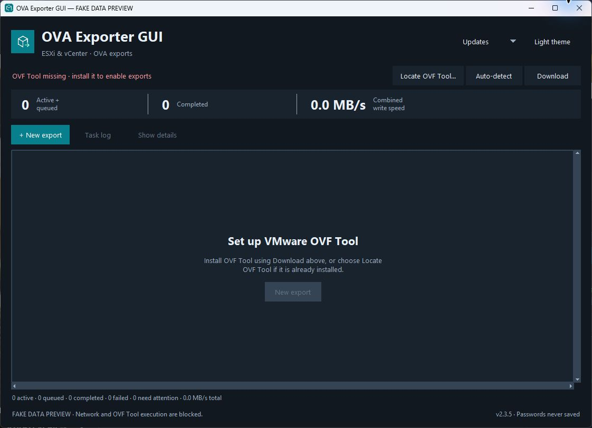
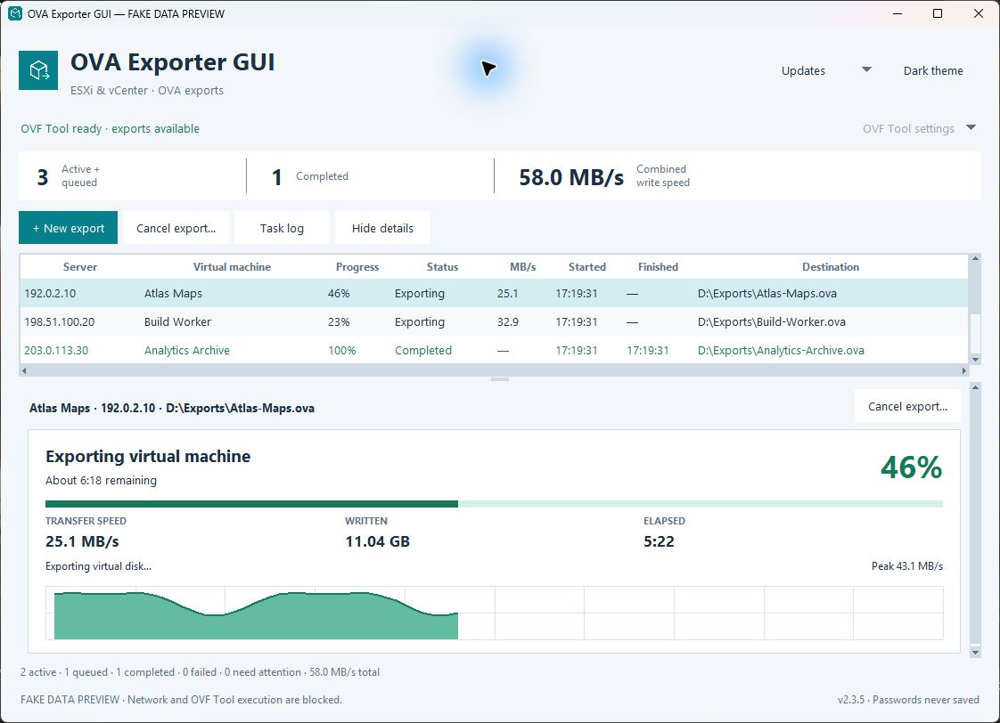
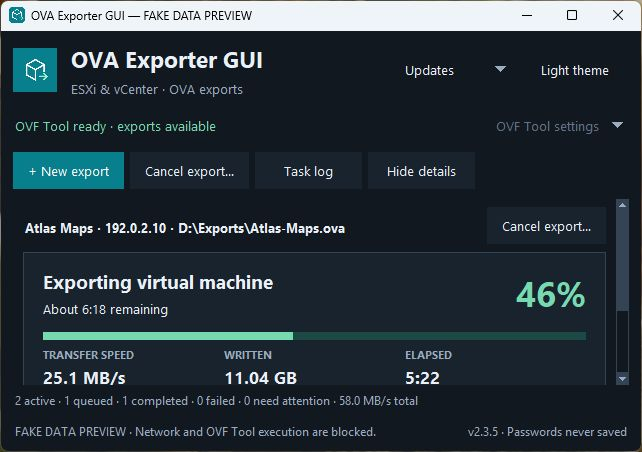
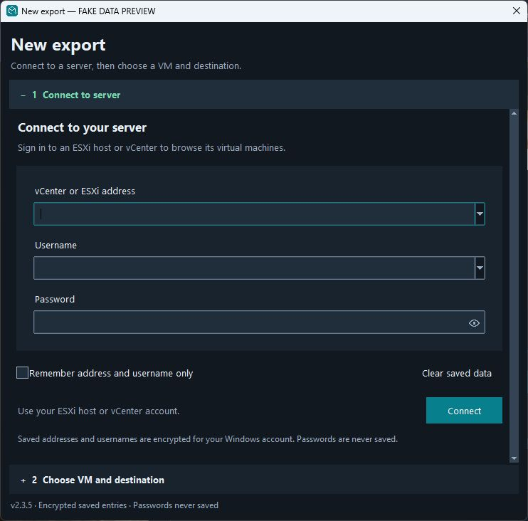
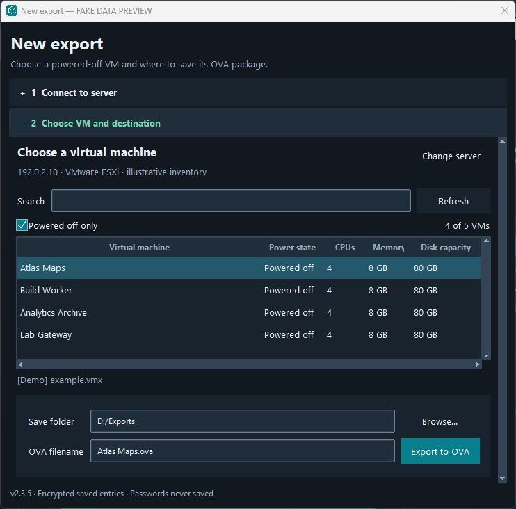

# OVA Exporter GUI


**A Windows GUI for VMware OVF Tool.** Browse powered-off virtual machines on ESXi or vCenter and export OVA packages with manifest checksum verification without writing shell commands.

Independent community project. Not affiliated with or endorsed by Broadcom or VMware.

Provided as is under the MIT license. See [responsibility and third-party terms](#license-responsibility-and-third-party-terms).

**[Download the Windows x64 installer](https://github.com/abdomitov/ova-exporter-gui/releases/download/v2.3.5/OVA-Exporter-GUI-2.3.5-Windows-x64-Setup.exe)**

[Release notes and SHA-256 checksums](https://github.com/abdomitov/ova-exporter-gui/releases/tag/v2.3.5)

This is a preview release for Windows 10/11 x64. Python/Tk are included in the
installer; VMware OVF Tool is a separate requirement. The installer is unsigned,
and live VMware validation remains a release check. Fresh installation and upgrade
are checked on disposable GitHub-hosted Windows runners.
macOS and Linux downloads are not available yet.

## Features

- Compact export dashboard; select a task to see its full progress and speed history.
- Light and dark themes, resizable windows, keyboard navigation and mouse-wheel scrolling.
- Startup OVF Tool detection, red missing-tool alert, and a custom-location picker.
- Background app update checks, Update / Remind me later / Skip this version choices,
  and verified installer downloads. Installation waits for exports to finish.
- ESXi and vCenter connections with a fresh password for each new setup session.
- Powered-off VM filter, search, destination selection and filename validation.
- Up to three concurrent exports across server addresses; one active export per address.
- Approximate time remaining, output-file write rate, elapsed time and peak speed.
- Manifest checksum verification before an `.incomplete` package becomes the final `.ova`.
- Optional remembered addresses/usernames and trusted certificate fingerprints, protected with Windows current-user DPAPI. The app does not write passwords to its settings files.

This release supports exporting to a local OVA. It does not implement VM deployment, live migration, snapshot backups or resumable transfers.

## Screenshots

Captured from the **2.3.5 UI** using the guarded fake-data preview. VM names,
addresses and progress are illustrative; no real infrastructure or credentials
appear in these images.



<details>
<summary>Light theme, compact layout, connection and VM selection</summary>











</details>

## App updates

Version 2.3.0 adds an **Updates** menu. By default, the app checks this public
GitHub repository once at startup for a newer Windows installer, including
published preview releases. Turn off **Check automatically at startup** to stop
automatic requests. **Check for updates…** also works manually and can show a
version you previously skipped.

The prompt offers **Update**, **Remind me later** (one day), and **Skip this
version**. Update downloads the installer and checks its size and SHA-256 against
the published checksum and GitHub asset digest when present. From an installed
copy of version 2.3.2 or later, choosing **Update** authorizes downloading and
installing the update, then reopening the app. Setup shows installation progress
without repeating the first-install pages. The existing folder and shortcut
choices are retained. Error dialogs and Windows security prompts can still appear;
the updater does not force a Windows restart or close other app instances.

Installation is blocked while tasks are queued, transferring, verifying or awaiting
cancellation/cleanup, or a New export window is open. If tasks start during the
download, installation is deferred; choose **Install now** after they finish.
Source/portable copies without an installed uninstaller keep the regular setup UI.
Versions 2.3.0/2.3.1 still open that regular wizard once when installing this
improvement; later updates started from 2.3.2 use the streamlined flow.

The update check sends no VMware credentials, server addresses or usernames.
GitHub receives the normal network request, including your public IP address.
An offline/failed automatic check does not interrupt exports. Update choices are
saved in `updates.json`; downloaded installers stay in the `updates/` subfolder
under the app's local data directory. A checksum is an integrity check, not a
publisher signature: installers remain unsigned. A downloaded installer is checked
again before launch. VMware OVF Tool is updated separately by the user.

**Users on 2.2.0 and earlier should install the current release manually once** to
receive this functionality; no intermediate version is required. Checks currently inspect the 30 most recent published GitHub
releases and offer only releases with a complete Windows installer/checksum pair.

**Maintainers:** no separate update server is required. A source push alone does
not announce an update. Publish a higher-version GitHub Release with the Windows
installer and matching checksum file. See [Publishing updates](docs/RELEASING.md)
for the build, release and installed-app validation steps.

## Requirements

- Windows 10/11 x64 is the target platform. Fresh install, upgrade and uninstall passed on a disposable GitHub-hosted Windows runner. Windows 10 and all end-user configurations remain unverified.
- Source users need Python 3.10 or newer with Tkinter. The Windows installer includes Python/Tk; users of that installer do not need a separate Python installation. No third-party Python packages are required to run the source app.
- [VMware OVF Tool](https://developer.broadcom.com/tools/open-virtualization-format-ovf-tool/latest/), installed separately under its own license.
- Access to the required VMware management and export endpoints and an account permitted to read inventory and export the chosen VM.
- A powered-off VM and sufficient free space for the export. The initial free-space check cannot predict the final compressed size.

## Run

**Windows users:** use the Windows x64 Setup executable from the project's
Releases when available. It includes Python/Tk and creates application shortcuts.
VMware OVF Tool is installed separately. See [installer details](docs/WINDOWS_INSTALLER.md).

**Developers/source users:**

1. Install Python with its Windows launcher and Tkinter support.
2. Install VMware OVF Tool.
3. Download/extract this source folder and double-click **Start OVA Exporter.vbs**.

If Windows Script Host is unavailable, use **Start OVA Exporter.cmd** or:

```powershell
py -3 launch.pyw
```

OVF Tool is located in this order: `OVFTOOL_PATH`, a private `ovftool/ovftool.exe` beside the app, the standard VMware installation under Program Files, then `PATH`. The public source archive contains no VMware executable or DLL.

When `OVFTOOL_PATH` is explicitly set, that exact path is used. A missing override
produces an error rather than selecting a different installation. Selecting an
executable with **Locate OVF Tool** takes priority over automatic detection and
the environment override. The custom location is encrypted for your Windows
account. **Auto-detect** clears that custom location and checks again.

The installation directory does not need to be the default one. Choose the
official `ovftool.exe` and keep its supporting DLLs/folders intact. A red
missing-tool alert blocks new export setup; a found-tool status confirms file
presence, not VMware connectivity or full runtime health. Active tasks must finish
before changing tool locations.

For a custom installation, set the executable path before launching:

```powershell
$env:OVFTOOL_PATH = 'D:\Tools\VMware OVF Tool\ovftool.exe'
py -3 launch.pyw
```

## Export a VM

1. Click **New export** or press **Ctrl+N**.
2. Enter an ESXi or vCenter address, username and password. Press **Enter** in the password field to connect. The eye toggles password visibility.
3. Verify the certificate fingerprint before accepting it. The app remembers that exact certificate; a changed fingerprint requires review again.
4. Choose a powered-off VM, folder and `.ova` filename, then add the task. Existing destination files are preserved.
5. Select its dashboard row for progress details. Add another export to work with another server.

The connection and selection sections keep their `+`/`−` headers. **F5** refreshes inventory; **Escape** closes an idle setup window. Shift+wheel scrolls tables horizontally. Drag the dashboard divider to resize its detail pane.

Use the top-right theme button to switch light/dark appearance. Short windows
hide the large summary cards to keep more room for the task table; the counts
and throughput remain available in the status line. Narrow windows prioritize
the server, VM, progress, status and speed columns; wider windows also show dates
and destination. Scroll the selected task's detail pane to see its full graph.

Server aliases and a vCenter plus its ESXi host can refer to the same physical resources. The per-address queue cannot identify all such overlaps. Concurrent exports still share your PC's NIC, storage and any common network links.

## Progress and cancellation

Speed is derived from OVA file growth, not total adapter traffic. ETA is approximate and excludes subsequent verification and server cleanup. A verified OVA with a source-state warning is distinguished from a failed transfer.

Here, "verified" means the archive passed this app's manifest checksum checks.
It does not prove the guest can boot, that its applications/data are consistent,
that the archive is malware-free, or that a restore will succeed. This utility
does not replace a tested backup and recovery system.

**Cancelling a remote export can leave some ESXi versions stuck in an exporting state**, blocking power-on or later exports. See [Broadcom KB 334593](https://knowledge.broadcom.com/external/article/334593/unable-to-power-on-vm-with-error-the-att.html). A warning does not prevent that server defect. Letting transfers finish is preferable where possible.

Queued tasks and local verification can be cancelled independently. An active-export cancellation requires confirmation. If OVF Tool stalls, a separate force-stop confirmation ends only the process owned by that task; it cannot guarantee server cleanup. The app never restarts ESXi services or changes VM power state. Incomplete files are not valid completed exports and cannot be resumed.

## Privacy

The compatible data directory remains `%LOCALAPPDATA%\OVA Exporter`:

| File | Contents |
| --- | --- |
| `connections.json` | DPAPI-encrypted address/username hints, only when requested |
| `trusted_servers.json` | DPAPI-encrypted approved certificate fingerprints |
| `appearance.json` | Plain `light`/`dark` preference only |
| `tool_location.json` | DPAPI-encrypted custom OVF Tool path |
| `updates.json` | Plain automatic-check, skipped-version and reminder preferences; no connection data |
| `updates/` | Downloaded app installers; no OVA exports or VMware credentials |

There is no analytics or telemetry code. Diagnostics and task rows stay in memory by default. **Clear saved data** removes connection hints and certificate approvals. Passwords, cookies and session tickets are not written to these settings files. DPAPI protects stored data from casual file inspection and other Windows users; software running as the same Windows user can still decrypt it.

## Development

Want to learn the delivery process? Follow [Learn DevOps with this project](docs/DEVOPS_PATH.md)
for the branch → CI → Windows build → installer checks → draft → reviewed release path,
with practical exercises and tradeoffs. Build-only workflow runs do not publish an update.

Read [CONTRIBUTING.md](CONTRIBUTING.md) and [the architecture notes](docs/ARCHITECTURE.md). The existing offline regression suite uses fake clients; do not point tests at a production server.

Run `py -3 tools/offline_tests.py` for guarded offline regressions. See the
[release review](docs/RELEASE_REVIEW.md) for findings, fixes and unverified lab checks.
The [security review](docs/SECURITY_REVIEW.md) describes the tested attack fixtures
and remaining risks; the [repository review](docs/REPOSITORY_REVIEW.md) records
the current documentation, screenshot and release-automation checks.

An isolated visual preview is available without credentials or VMware binaries:

```powershell
py -3 tools/preview_ui.py
```

It injects in-memory settings, fake VM inventory and progress, and blocks socket connections and subprocess creation. It cannot export a VM or save connection settings.

The repository keeps application code in `src/`, regression tests in `tests/`,
build helpers in `tools/`, installer configuration in `packaging/`, and user/developer
documentation in `docs/`. End users only need the installer download.

## License, responsibility and third-party terms

This project's source and published GitHub downloads are offered without payment
to the maintainers under the [MIT license](LICENSE), including its warranty
disclaimer and limitation of liability. The software is provided **as is**,
without a guarantee of error-free operation, suitability, successful recovery,
or protection against data loss. Use only on systems you are authorized to manage;
maintain independent backups and validate behavior in a disposable lab first.

Broadcom and VMware do not publish, endorse, certify or provide support for this
community project. We make no commitments on their behalf. VMware OVF Tool and
other VMware products retain their own license, support and commercial terms;
this project does not provide vendor licenses or waive vendor requirements,
charges, rights or obligations. Broadcom/VMware binaries are not included.

These notices describe this project's terms; they do not guarantee immunity from
claims or override applicable law. See [third-party notices](THIRD_PARTY_NOTICES.md).

## License

Application code: [MIT](LICENSE). VMware OVF Tool and Python retain their own licenses; they are not included in this source distribution. See [THIRD_PARTY_NOTICES.md](THIRD_PARTY_NOTICES.md).
