# Learn DevOps with OVA Exporter GUI

This is a desktop application. Its delivery destination is a verified Windows
installer on GitHub Releases, not a Kubernetes cluster. The useful DevOps path is
code review, repeatable builds, testing, security checks, controlled releases,
feedback and recovery. Infrastructure automation can follow in a separate lab.

## The path through this repository

```mermaid
flowchart LR
  change[Small code change] --> branch[Feature branch + pull request]
  branch --> ci[Tests + dependency audit]
  ci --> review[Review and merge]
  review --> build[Run release-candidate workflow]
  build --> installer[Build + frozen app + isolated installer checks]
  installer --> artifact[Versioned files + checksums + build manifest]
  artifact --> draft[Optional draft release]
  draft --> decision[Human review and publish confirmation]
  decision --> release[Public GitHub Release]
  release --> client[Installed app checks and offers update]
  client --> feedback[Sanitized bug reports and next patch]
  feedback --> change
```



**CI (continuous integration)** checks changes when a branch is pushed or a pull
request is opened. **Continuous delivery** prepares a tested release candidate.
**Continuous deployment** would publish every eligible change automatically. This
project keeps an explicit human publish decision because publication makes a
version available to installed updaters, including published preview releases.

## Guided stages

| Stage | What you learn | Practice in this project |
| --- | --- | --- |
| 1. Git workflow | Branches, diffs, pull requests, review and merge | Make one small change and read the PR diff before merging. |
| 2. CI | Jobs, runners, matrices, failures and logs | Windows tests on Python 3.10/3.14 and a build-dependency audit. |
| 3. Build | Toolchains, packaging and artifacts | Frozen Python/Tk app, pinned Inno compiler, installer and source ZIP. |
| 4. Test environments | Test isolation and test scope | Fake VMware tests locally; real install/upgrade/reopen/uninstall only on a disposable GitHub-hosted runner. |
| 5. Delivery | Versions, hashes, build identity and release candidates | A manifest ties the release files to a commit and workflow run, and publishing re-checks it. |
| 6. Deployment | Approval, exact artifacts and user impact | Merging a higher version to `main` is the approval; the pipeline publishes only after every check passes. |
| 7. Operations | Failure reports, recovery and communication | Review sanitized reports, withdraw a bad release and ship a higher-version fix. |
| 8. Supply-chain improvements | Signing, provenance, SBOMs and dependency locks | Add verified publisher signing and stronger provenance after the base pipeline works. These are not implemented by the initial pipeline. |
| 9. Lab infrastructure | IaC, configuration and integration testing | Later use Terraform/Ansible for a separately authorized disposable vSphere lab, documented with the homelab project. |

Keep learning progress here or in the relevant project repository. The GitHub
profile should describe demonstrated work rather than planned proficiency.

## What each workflow does

### Windows offline tests

Runs after eligible pushes and pull requests. It checks the supported Python
versions, fake UI, source packaging and known vulnerabilities in Python build
requirements. Pull-request jobs have read-only repository permissions and do not
receive a release/signing secret. Actions are pinned to full commit IDs.

### CI/CD (`release.yml`)

Runs on every push to `main`. A push that keeps the same `VERSION` only runs the tests. Raising the
version (with `python tools/bump_version.py X.Y.Z`) also builds, verifies and publishes a release.

```powershell
gh run list --workflow release.yml
gh run view RUN_ID --log-failed
gh run download RUN_ID -n windows-release-RUN_ID
```

Replace `RUN_ID` with the actual numeric run ID. The jobs:

1. **plan**: compares `VERSION` with existing tags; a lower version fails, an existing one skips release.
2. **validate**: guarded tests and the fake-data UI check on Python 3.10 and 3.14.
3. **build** (new versions only): audits the pinned build tools, provisions a verified Inno Setup, builds the
   app, license texts and installer, runs the frozen self-test, installs into a fresh directory, checks startup
   and uninstalls, then installs the pinned public 2.3.1 baseline and runs the real update, checking parent-exit
   waiting, the replaced app and reopening. It writes `build-manifest.json` with the commit, run and runtime
   versions. No VMware credentials or servers are used, and local or self-hosted runners are refused.
4. **build-macos** (new versions only): calls `macos.yml`, which runs the tests on an Intel Mac, builds the
   `.app` and `.dmg` with `tools/build_macos.sh`, launches the frozen app, installs it from the mounted
   disk image and writes `macos-manifest.json`.
5. **publish**: the only job with `contents: write`. It checks the manifest against this exact commit and run,
   re-verifies the files and source archive, confirms `main` and the tag state, and creates the public release.
   If a newer commit has landed on `main`, it publishes nothing and lets that commit's own run decide.

Pull requests and feature branches run only **Windows offline tests** with read-only permissions, so
a pull request can never publish. Bad code is stopped by required checks on `main` (repository
setting) and a failed run, not by a click after the fact.

## Downsides and practical limits

| Tradeoff | What can go wrong | How to handle it |
| --- | --- | --- |
| More automation | A bad workflow can distribute a bad installer quickly. | Required pull-request checks on `main`, exact-version and manifest checks, and one job holding write access. |
| Green tests have limits | Fake VMware tests do not prove real export/cancellation behavior. | Keep an authorized disposable integration lab as a separate future gate. |
| Installer test scope | A hosted Windows runner is not every Windows 10/11 machine, GPO, antivirus or custom environment. | Record the environment; add representative VMs before broader support claims. |
| External services | GitHub, PyPI, advisory databases and runtime-license endpoints can be unavailable. | Fail visibly, keep logs and retry after understanding the failure. No security-check bypass. |
| Dependencies change | A new advisory can block yesterday's passing dependencies. | Review and update the affected dependency; do not routinely ignore the finding. |
| Reproducibility | Python patch versions, hosted images and transitive packages can change. | Record the actual environment. Full hash-locked dependencies and stronger build reproducibility remain future work. |
| Signing | Checksums and manifests do not establish publisher identity. | Installers remain unsigned; code signing needs a verified identity/service. SmartScreen can still appear. |
| Rollback | Removing a bad release cannot undo already installed copies; the updater does not downgrade. | Stop offering it, communicate the issue and publish a corrected higher-version patch. |
| Cost/storage | Public standard-runner compute is free, but storage quotas, larger runners or private-repo usage can change costs. | Use standard runners, bounded jobs, small artifacts and short retention. Check account budgets before paid services. |
| Access control | Workflow checks alone do not prevent a maintainer bypassing the intended process. | Consider required PR/status checks and deployment reviewers as an explicit repository-admin step. |
| Maintenance | Toolchain pins, audit tooling and baseline installers age. | Review updates and keep the baseline/check procedure documented. |

GitHub documents [public standard-runner billing](https://docs.github.com/en/billing/concepts/product-billing/github-actions),
[pinned action security](https://docs.github.com/en/actions/reference/security/secure-use-reference),
and [deployment approval environments](https://docs.github.com/en/actions/how-tos/deploy/configure-and-manage-deployments/manage-environments).
No paid service, signing identity, private network access or repository protection
setting is enabled by these workflow files.

## Your first exercise

1. Open the pull request for the pipeline and inspect **Files changed**.
2. Open **Checks** and one successful job; identify the runner, Python version and commands.
3. Inspect a failed run if one occurred. Locate the first failing step and distinguish a code bug from an unavailable dependency or OS execution block.
4. Open the latest **CI/CD** run on `main`. Find the **plan** job's summary and read why it did or did not release.
5. Download the `build-reports` artifact of a release run and inspect its manifest and check reports.
