# Learn DevOps with OVA Exporter GUI

This is a desktop application. Its delivery destination is a verified Windows
installer on GitHub Releases, not a Kubernetes cluster. The useful DevOps path is
code review, repeatable builds, testing, security checks, controlled releases,
feedback and recovery. Infrastructure automation can follow in a separate lab.

## The path through this repository

```mermaid
flowchart LR
  change[Small code change] --> branch[Feature branch + pull request]
  branch --> ci[Tests + dependency audit]
  ci --> review[Review and merge]
  review --> build[Run release-candidate workflow]
  build --> installer[Build + frozen app + isolated installer checks]
  installer --> artifact[Versioned files + checksums + build manifest]
  artifact --> draft[Optional draft release]
  draft --> decision[Human review and publish confirmation]
  decision --> release[Public GitHub Release]
  release --> client[Installed app checks and offers update]
  client --> feedback[Sanitized bug reports and next patch]
  feedback --> change
```



**CI (continuous integration)** checks changes when a branch is pushed or a pull
request is opened. **Continuous delivery** prepares a tested release candidate.
**Continuous deployment** would publish every eligible change automatically. This
project keeps an explicit human publish decision because publication makes a
version available to installed updaters, including published preview releases.

## Guided stages

| Stage | What you learn | Practice in this project |
| --- | --- | --- |
| 1. Git workflow | Branches, diffs, pull requests, review and merge | Make one small change and read the PR diff before merging. |
| 2. CI | Jobs, runners, matrices, failures and logs | Windows tests on Python 3.10/3.14 and a build-dependency audit. |
| 3. Build | Toolchains, packaging and artifacts | Frozen Python/Tk app, pinned Inno compiler, installer and source ZIP. |
| 4. Test environments | Test isolation and test scope | Fake VMware tests locally; real install/upgrade/reopen/uninstall only on a disposable GitHub-hosted runner. |
| 5. Delivery | Versions, hashes, build identity and release candidates | A manifest ties candidate files to a commit and workflow run. Drafts stay invisible to the updater. |
| 6. Deployment | Approval, exact artifacts and user impact | The publish workflow requires an explicit tag/commit/confirmation and rechecks the files. |
| 7. Operations | Failure reports, recovery and communication | Review sanitized reports, withdraw a bad release and ship a higher-version fix. |
| 8. Supply-chain improvements | Signing, provenance, SBOMs and dependency locks | Add verified publisher signing and stronger provenance after the base pipeline works. These are not implemented by the initial pipeline. |
| 9. Lab infrastructure | IaC, configuration and integration testing | Later use Terraform/Ansible for a separately authorized disposable vSphere lab, documented with the homelab project. |

Keep learning progress here or in the relevant project repository. The GitHub
profile should describe demonstrated work rather than planned proficiency.

## What each workflow does

### Windows offline tests

Runs after eligible pushes and pull requests. It checks the supported Python
versions, fake UI, source packaging and known vulnerabilities in Python build
requirements. Pull-request jobs have read-only repository permissions and do not
receive a release/signing secret. Actions are pinned to full commit IDs.

### Build Windows release candidate

Run this manually on `main`. The default `create_draft=false` builds and uploads
artifacts only. It does not publish anything or notify installed app users.

```powershell
gh workflow run release-build.yml --ref main -f create_draft=false
gh run list --workflow release-build.yml
gh run view RUN_ID --log-failed
gh run download RUN_ID -n windows-release-RUN_ID
```

Replace `RUN_ID` with the actual numeric run ID. The workflow:

1. Runs guarded tests and fake-data UI checks.
2. Installs the pinned Python build tools and audits the resolved Windows environment.
3. Downloads a fixed Inno Setup version, verifies its pinned SHA-256 and publisher signature, and provisions it on the disposable runner.
4. Builds the app, runtime license texts and Windows installer.
5. Runs the frozen app with its fake-only self-test.
6. Installs the pinned public 2.3.1 baseline into a new CI directory, runs the actual candidate update, verifies the replaced app and reopen, then uninstalls it. No VMware credentials or servers are used. The script refuses local or self-hosted runners.
7. Verifies the exact source/archive files, checksums and check reports; writes `build-manifest.json` with the commit, workflow run and runtime versions.
8. Keeps the small release files and diagnostic reports as artifacts for seven days.

To prepare a draft for a **new app version**, first bump/review/merge that version,
then run the same workflow with `create_draft=true`. The draft job uses a temporary
GitHub token with release-write permission; build/test jobs remain read-only.
An already published version fails draft creation instead of replacing its files.

### Publish reviewed release

This workflow is a deliberate deployment action. Review the draft changes and
its exact candidate before running it. Select the tag and 40-character commit
and set `confirm_publish=true`. It checks:

- The selected commit is still current `main` and matches the draft and manifest.
- The exact files match their SHA-256 sidecars and recorded build hashes.
- The source ZIP matches the reviewed checkout and source allowlist.
- Frozen/installer checks passed and the referenced build run succeeded.

Only then does it change the draft to a public release. It never moves a tag or
replaces an existing asset. The human confirmation is a solo-maintainer gate,
not an independent second-person review or a configured protected environment.
Do not run it just to experiment: publishing is visible to app updaters.

## Downsides and practical limits

| Tradeoff | What can go wrong | How to handle it |
| --- | --- | --- |
| More automation | A bad workflow can distribute a bad installer quickly. | Draft first, exact-version checks and a separate explicit publish step. |
| Green tests have limits | Fake VMware tests do not prove real export/cancellation behavior. | Keep an authorized disposable integration lab as a separate future gate. |
| Installer test scope | A hosted Windows runner is not every Windows 10/11 machine, GPO, antivirus or custom environment. | Record the environment; add representative VMs before broader support claims. |
| External services | GitHub, PyPI, advisory databases and runtime-license endpoints can be unavailable. | Fail visibly, keep logs and retry after understanding the failure. No security-check bypass. |
| Dependencies change | A new advisory can block yesterday's passing dependencies. | Review and update the affected dependency; do not routinely ignore the finding. |
| Reproducibility | Python patch versions, hosted images and transitive packages can change. | Record the actual environment. Full hash-locked dependencies and stronger build reproducibility remain future work. |
| Signing | Checksums and manifests do not establish publisher identity. | Installers remain unsigned; code signing needs a verified identity/service. SmartScreen can still appear. |
| Rollback | Removing a bad release cannot undo already installed copies; the updater does not downgrade. | Stop offering it, communicate the issue and publish a corrected higher-version patch. |
| Cost/storage | Public standard-runner compute is free, but storage quotas, larger runners or private-repo usage can change costs. | Use standard runners, bounded jobs, small artifacts and short retention. Check account budgets before paid services. |
| Access control | Workflow checks alone do not prevent a maintainer bypassing the intended process. | Consider required PR/status checks and deployment reviewers as an explicit repository-admin step. |
| Maintenance | Toolchain pins, audit tooling and baseline installers age. | Review updates and keep the baseline/check procedure documented. |

GitHub documents [public standard-runner billing](https://docs.github.com/en/billing/concepts/product-billing/github-actions),
[pinned action security](https://docs.github.com/en/actions/reference/security/secure-use-reference),
and [deployment approval environments](https://docs.github.com/en/actions/how-tos/deploy/configure-and-manage-deployments/manage-environments).
No paid service, signing identity, private network access or repository protection
setting is enabled by these workflow files.

## Your first exercise

1. Open the pull request for the pipeline and inspect **Files changed**.
2. Open **Checks** and one successful job; identify the runner, Python version and commands.
3. Inspect a failed run if one occurred. Locate the first failing step and distinguish a code bug from an unavailable dependency or OS execution block.
4. Run the build workflow with `create_draft=false` and inspect its manifest/reports.
5. Stop there until you are ready to prepare a real new-version draft. Publishing
   an update is a separate decision, not a required part of the first exercise.
